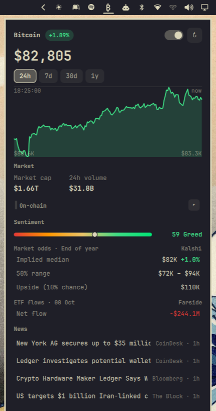
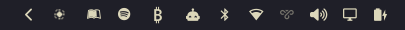
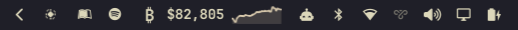

# Satscope

**Bitcoin, at a glance.**

A Bitcoin bar widget for [Omarchy](https://omarchy.org/) — the price and a
sparkline in the bar, and a click away from on-chain metrics, US spot-ETF
flows, prediction-market odds, and curated news. No API keys, no accounts.



## Features

- **Bar** — live BTC price, a selectable 24h/7d/30d/1y sparkline, and an
  optional 24h change. A **subtle** mode collapses the widget to a `₿` badge
  that expands on hover to reveal the price and chart.
- **Chart** — range-selectable price chart with min/max labels.
- **On-chain** — block height, recommended fees, hash rate, difficulty
  adjustment, and a halving countdown (collapsible).
- **Sentiment** — the Alternative.me Fear & Greed index on a five-band gauge.
- **ETF flows** — the latest settled US spot-bitcoin ETF net flow (Farside).
- **Market odds** — Kalshi's implied year-end BTC price distribution: median,
  interquartile range, and 90th percentile.
- **Market** — market cap and 24h volume.
- **News** — curated crypto/macro headlines from FT, The Block, CoinDesk,
  Bloomberg, and CNBC, de-duplicated and relevance-filtered.

### Bar appearance

Subtle — the `₿` badge:



Hovering it expands to the full price and chart:



## Install

```sh
omarchy plugin add https://github.com/nautilusmare/omarchy-satscope.git --enable
```

Then add the **Satscope** widget to your bar through the Omarchy bar settings.

## Use

- **Left-click** the bar widget to open the panel; left-click again or press
  `Esc` to close.
- **Middle-click** the widget to force-refresh every data source.
- Keyboard (panel open): arrow keys move between the range selector, refresh,
  appearance toggle, and the On-chain header; `Enter`/`Space` activates; `r`
  refreshes.
- Hover the **On-chain** header to expand or collapse the on-chain metrics.
- Hover the **appearance switch** for a tooltip; click it to toggle between the
  full price and the subtle `₿` badge.

## Configure

Widget settings (your Omarchy bar configuration, `shell.json`) or the in-panel
controls:

| Setting | Values | Default | Description |
|---|---|---|---|
| `currency` | `USD`, `EUR`, `GBP`, `CAD`, `CHF`, `AUD`, `JPY` | `USD` | Quote currency |
| `chartRange` | `24h`, `7d`, `30d`, `1y` | `24h` | Sparkline / chart range |
| `refreshIntervalSec` | `30`–`600` | `60` | Price refresh interval (seconds) |
| `sparkline` | `true` / `false` | `true` | Show the bar sparkline |
| `showChange` | `true` / `false` | `false` | Show 24h change in the bar |
| `barAppearance` | `full`, `subtle` | `full` | Full price + chart, or a `₿` badge that expands on hover |

## Data sources

All public and key-less:

- [mempool.space](https://mempool.space) — price, block height, fees, hash rate, difficulty
- [CoinGecko](https://www.coingecko.com) — spot price and historical chart
- [Alternative.me](https://alternative.me/crypto/fear-and-greed-index/) — Fear & Greed index
- [Farside Investors](https://farside.co.uk/btc/) — US spot-bitcoin ETF daily net flows
- [Kalshi](https://kalshi.com) — implied BTC price distribution (series `KXBTCY`)
- RSS: [FT](https://www.ft.com), [The Block](https://www.theblock.co), [CoinDesk](https://www.coindesk.com), [Bloomberg](https://www.bloomberg.com), [CNBC](https://www.cnbc.com)

The widget is read-only: it issues outbound GET requests to the endpoints above
and never writes outside its own state file
(`~/.local/state/omarchy/maurice.bitcoin/state.json`).

## Remove

```sh
omarchy plugin remove maurice.bitcoin
```

## License

[MIT](LICENSE)
